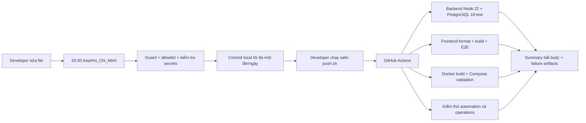

# ResearchOS — CI/CD và daily commit

Chỉ dùng repository `vanmo1202/ResearchOS`, thư mục
`/home/vanmo/projects/ResearchOS`, nhánh `automation-ci-cd`.
Không có bước triển khai VPS, SSH, publish image, tạo PR hoặc merge.

## Kiến trúc



`automation-ci-cd.yml` nhận push/PR vào nhánh phát triển và chạy thủ công.
Nó gọi `production-readiness.yml` qua `workflow_call`, dùng chung các job
với readiness của main, tránh chạy hai bản kiểm thử giống nhau trên một push.
Mỗi job có timeout; concurrency hủy run cũ của cùng workflow/ref.
Quyền mặc định chỉ `contents: read`; không truyền secrets cho workflow con,
không dùng `pull_request_target`, checkout không lưu credentials.

Backend dùng PostgreSQL 18 service riêng trên runner tạm, database
`researchos_test_ci`; preload có sẵn tạo schema `test_*` riêng cho từng file.
`RESEARCH_LOAD_ENV=false`, mock providers, key giả và preload chặn HTTP trực tiếp
đến Gemini/Tavily. Các test lỗi provider vẫn có thể mock transport như trước.
Không có thông số kết nối database production.

Frontend chạy đầy đủ ba suite được cấu hình trong readiness: rebuild (baseline
WF01 39 test, gồm mọi responsive case), unified chat và analytics, không grep,
skip hoặc đổi layout. `playwright.config.js`/`test:legacy` là suite API/UI cũ,
yêu cầu PostgreSQL/schema riêng và không thuộc baseline WF01 đã xác minh;
không dùng suite đó thay thế cho các suite hiện hành.

Docker job build cả Dockerfile local (`backend`, `frontend`) lẫn bản hardened
(`deploy/Dockerfile.*`) bằng đúng context ứng dụng. Không có `--push`, không
chạy image. Compose được copy vào thư mục tạm, chỉ đọc `.env` rỗng và secrets
placeholder tự tạo tại đó. Kiểm tra worker dùng chung image/build với backend,
và chạy hardened topology preflight. Không gọi `up`, `down`, restart hay xóa volume.

Summary chạy với `always()` và chỉ PASS khi mọi job bắt buộc đều success;
FAIL, cancelled hoặc skipped đều làm summary thất bại. Muốn bắt buộc khi merge,
maintainer cần tự cấu hình branch protection cho check `Required validation summary`;
workflow không tự thay đổi cài đặt repository.

## Commit local và push GitHub

Commit ghi snapshot vào lịch sử Git **trên máy này**. Push mới gửi các commit
đã có lên GitHub và kích hoạt CI. Daily commit không push; commit thủ công không
bị giới hạn số lần/ngày.

```bash
cd /home/vanmo/projects/ResearchOS
bash scripts/dev/daily-commit.sh --dry-run
bash scripts/dev/daily-commit.sh
# Chạy riêng khi muốn gửi các commit đã kiểm tra lên GitHub:
bash scripts/dev/safe-push.sh
```

Script push kiểm tra đường dẫn/nhánh/remote, fetch đúng nhánh trước, xác minh
remote là tổ tiên của HEAD rồi push refspec cụ thể, không force/merge/rebase.
Remote ahead hoặc phân kỳ sẽ bị chặn để developer xử lý thủ công. Nếu remote
thay đổi ngay sau kiểm tra, GitHub vẫn từ chối push non-fast-forward.
Lần publish đầu được phép sau khi xác nhận remote branch chưa tồn tại.
Remote được chấp nhận chính xác là `https://github.com/vanmo1202/ResearchOS.git`
cho cả fetch và push; nhiều URL, URL rewrite sang remote khác hoặc SSH URL bị chặn.

## Chính sách daily commit

- Chỉ chạy đúng thư mục và nhánh. Có lock `flock` trong `.git`, chặn Git đang
  merge/rebase/cherry-pick/bisect, conflict hoặc index lock.
- Nếu đã stage file, dừng và giữ nguyên staging của developer.
- Allowlist nằm trong `scripts/dev/commit-policy.py`: các cây source/test, docs,
  scripts, n8n workflow dạng text và một số file cấu hình được nêu đích danh.
  File ngoài danh sách không được stage. Không dùng `git add -A`.
- Chặn tên/path nhạy cảm dù nằm trong allowlist: `.env`, credentials, secrets,
  API keys, passwords, certificates, backup, dump, runtime data, dependencies,
  build output và log. Không commit symlink, submodule, binary hay file trên 2 MB.
- Trước khi stage thật, tạo index tạm, scan toàn bộ nội dung blob đã chọn và chạy
  `git diff --cached --check`. Dry-run không sửa index thật hay tạo commit.
- Scanner chặn token phổ biến, private key/certificate, URL có credentials và
  credential assignment không phải placeholder/reference. Không in nội dung bị chặn.
  Đây là kiểm tra bảo thủ, không phải bảo đảm tìm được mọi secret; có thể chặn
  nhầm dữ liệu test. Developer phải review thủ công, không tắt scanner để timer chạy.
- Sau staging thật, scan/check lại và so sánh snapshot. Nếu file thay đổi đồng thời,
  hook thất bại hoặc Git lỗi: không tự sửa code; staging có thể được giữ lại để review.
  Lock chỉ phối hợp các script automation, developer nên tránh chạy Git song song.
- Thông điệp: `chore(daily): ResearchOS update YYYY-MM-DD`, ngày theo Việt Nam.
  Kiểm tra cả lịch sử reachable của HEAD và marker `.git/researchos-daily/YYYY-MM-DD`.
  Nếu đã có: `ALREADY COMMITTED`. Không có thay đổi được phép: `NO CHANGES`.
  Không tạo file/code giả hoặc empty commit. Không tự gọi push/deploy.

## Cài systemd user timer

Yêu cầu Ubuntu có Git, Bash, Python 3, `flock`, systemd user manager và Git identity
đã cấu hình. Các script không cần Node; PATH trong service chỉ dùng system binaries.
Không chạy bằng sudo/root. Các unit trong repository chỉ là template, chưa được enable.

```bash
cd /home/vanmo/projects/ResearchOS
bash scripts/dev/daily-commit.sh --dry-run
systemd-analyze calendar '*-*-* 20:30:00 Asia/Ho_Chi_Minh'
systemd-analyze --user verify scripts/dev/systemd/researchos-daily-commit.{service,timer}
mkdir -p ~/.config/systemd/user
install -m 0644 scripts/dev/systemd/researchos-daily-commit.{service,timer} ~/.config/systemd/user/
systemctl --user daemon-reload
systemctl --user enable researchos-daily-commit.timer
systemctl --user start researchos-daily-commit.timer
```

`OnCalendar` chỉ định timezone trực tiếp, không phụ thuộc timezone hệ thống.
`Persistent=true` chạy bù một lượt khi user manager trở lại sau khi máy tắt;
không tạo commit cho từng ngày đã bỏ lỡ. Ngày commit là ngày thực sự chạy.
Timer có độ chính xác một phút, không bảo đảm chạy đúng giây 20:30:00.
Muốn chạy khi đã logout cần user manager hoạt động (linger là lựa chọn quản trị
riêng); tài liệu này không tự bật linger hoặc thay đổi cấu hình hệ thống.

```bash
systemctl --user status researchos-daily-commit.timer
systemctl --user list-timers --all researchos-daily-commit.timer
systemctl --user cat researchos-daily-commit.timer
journalctl --user -u researchos-daily-commit.service -n 80 --no-pager
# Dừng lịch hiện tại:
systemctl --user stop researchos-daily-commit.timer
# Bỏ tự kích hoạt ở các phiên sau:
systemctl --user disable researchos-daily-commit.timer
# Hoặc cả hai:
systemctl --user disable --now researchos-daily-commit.timer
```

## Xem CI và xử lý FAIL

Mở GitHub → Actions → **ResearchOS automation CI/CD** → chọn run và job.
Không cần bật timer để chạy CI. Vì workflow mới chỉ nằm trên nhánh phát triển,
nút **Run workflow** có thể chưa xuất hiện trên UI (GitHub yêu cầu file trên
default branch cho nút này). Sau lần push chạy đầu tiên, có thể dispatch qua CLI
vào đúng nhánh, hoặc rerun một run đã có. Không cần sửa main. Xem
[GitHub workflow_dispatch](https://docs.github.com/en/actions/reference/workflows-and-actions/events-that-trigger-workflows#workflow_dispatch).

```bash
gh workflow run automation-ci-cd.yml --ref automation-ci-cd --repo vanmo1202/ResearchOS
gh run list --repo vanmo1202/ResearchOS --workflow automation-ci-cd.yml --branch automation-ci-cd
gh run view RUN_ID --repo vanmo1202/ResearchOS
gh run view RUN_ID --repo vanmo1202/ResearchOS --log-failed
gh run download RUN_ID --repo vanmo1202/ResearchOS --dir /tmp/researchos-ci-artifacts
```

Summary tổng hợp trạng thái. Artifacts lỗi giữ 7 ngày: backend test/install/audit
logs; frontend logs, HTML report và screenshots; Docker/Compose logs; automation
và operations logs. Các suite browser dùng thư mục output riêng để không ghi đè nhau.
Nếu checkout/service lỗi trước khi bước upload chạy, xem runner/service log trực tiếp.

Khi FAIL: đọc bước lỗi đầu tiên, phân biệt dependency/network/runner với assertion.
Chỉ sửa CI/CD khi lỗi do cấu hình; không đổi WF01, layout hoặc xóa responsive tests
để lấy PASS. Audit phát hiện dependency rủi ro sẽ chặn readiness; xử lý nâng package
trong công việc riêng được review. Không chạy test backend bằng database production.
Không in `.env` hoặc key thật để debug. Có thể tái chạy failed job khi xác định lỗi hạ tầng.

Kiểm thử automation an toàn, không tạo commit thử trong source:

```bash
python3 -m unittest discover -s scripts/dev/tests -v
bash -n scripts/dev/daily-commit.sh scripts/dev/safe-push.sh scripts/dev/git-guard.sh
python3 scripts/ci/validate-compose.py
```

## CI, delivery, deployment và chi phí

**Continuous Integration** kiểm tra commit bằng test/build. **Continuous Delivery**
chuẩn bị bản có thể phát hành với quyết định phát hành thủ công. **Continuous Deployment**
tự triển khai production sau kiểm tra. Hệ thống hiện tại là CI và validation hỗ trợ
delivery; chưa có bước release hay deployment, không phải CD lên VPS.

GitHub Actions có thể tính runner minutes và artifact storage tùy gói repository;
Docker build bốn image tốn nhiều hơn chỉ build local image. Cache npm, hủy run trùng,
timeout và retention 7 ngày giúp giới hạn chi phí. Không dùng API provider trả phí.
PR vẫn chạy code của contributor trên runner tạm với quyền đọc; không gắn secrets
hoặc self-hosted runner cho workflow này. Scanner không thay thế code review hay
GitHub secret scanning; artifact access theo quyền GitHub của repository.

Để tắt CI tự động: tắt workflow **ResearchOS automation CI/CD** trong Actions,
hoặc chỉnh triggers qua commit được review; readiness trên main là workflow riêng.
Tắt timer chỉ tắt commit local, không xóa commit hoặc ảnh hưởng push thủ công.

## Kết quả xác minh 2026-11-28 (Asia/Ho_Chi_Minh)

[Run 46039185377](https://github.com/vanmo1202/ResearchOS/actions/runs/46039185377)
trên commit triển khai `42f5c08`: **SUCCESS**, cả năm job kể cả summary PASS.
Backend Node 22/PostgreSQL 18: **222/222**, không skip/cancel; audit **0 vulnerabilities**.
Frontend: **39 rebuild + 8 unified chat + 4 analytics PASS**, format/build PASS.
Bốn Docker image build và placeholder Compose/preflight PASS trên runner GitHub.
Automation **16/16** và operations **12/12** PASS cả local và CI.
Local còn xác minh actionlint, shellcheck, Bash syntax, dry-run, systemd unit và
calendar 20:30 +07. Timer chưa được cài/enable; không chạm container/database thật.
Follow-up chỉ cập nhật tài liệu, dùng `[skip ci]` để không lặp regression.
